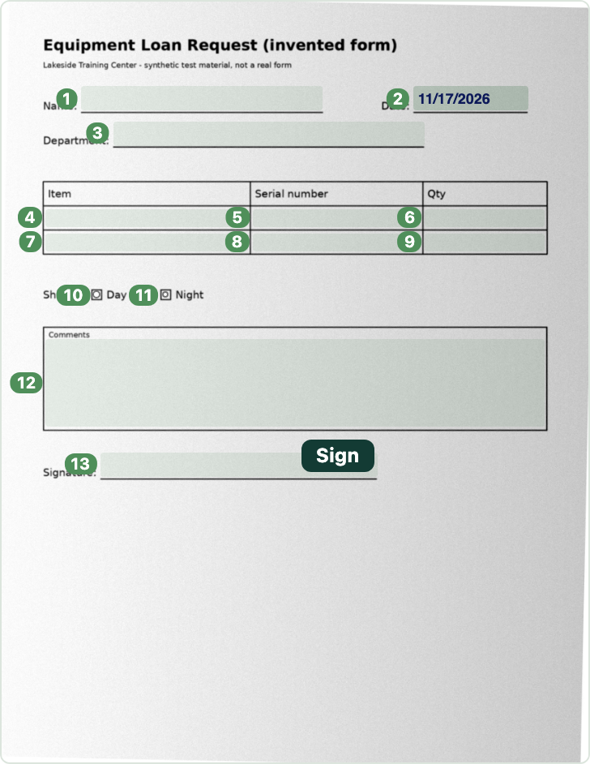
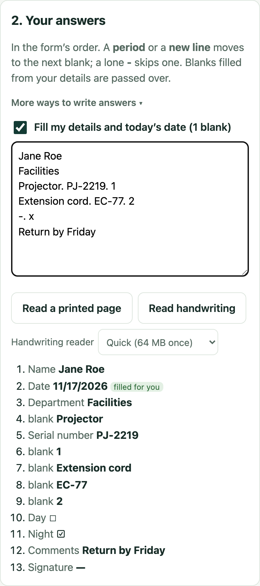
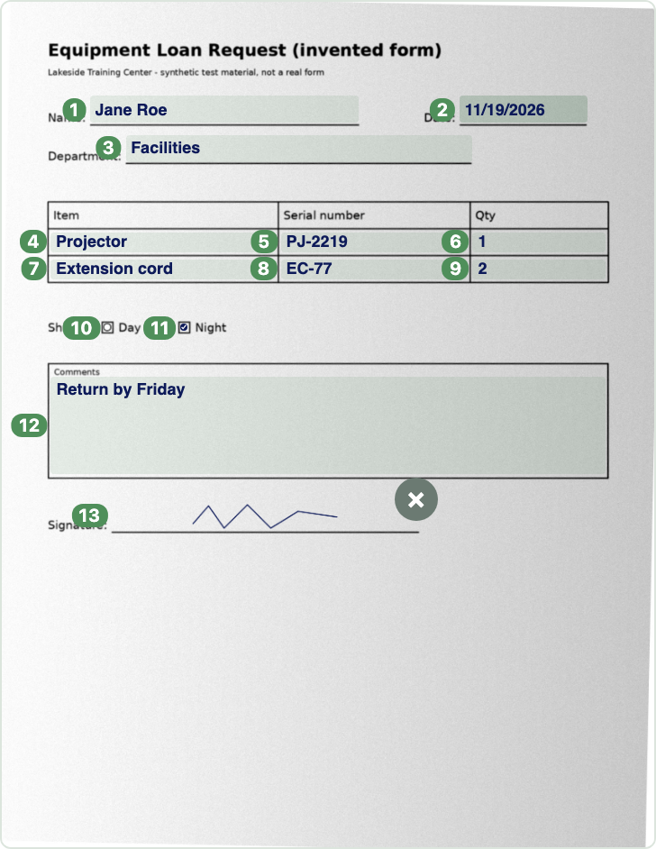
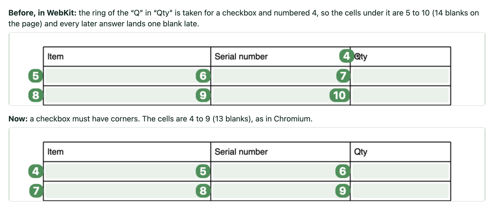

# Form Filler

Photograph or open a form, write your answers as plain lines, and get the form back filled in: as a PDF you can still
edit, a print-ready PDF, or printed. It runs in your browser, on your own device. The form, your answers and your
details are not uploaded anywhere. It installs like an app (Add to Home Screen) and works offline after the first
visit.

It is also a library and a command-line tool, so other programs can fill forms with it.

**Open it:** <https://swixixle.github.io/form-filler/>. The foot of the page names the version you have; this README
describes 2.3.0, and what changed in each version is in [CHANGELOG.md](CHANGELOG.md).

Everything below describes what works today, except the section headed [Roadmap](#roadmap-planned-not-built), which
is planned and not built.

## How to use it

The pictures are the page itself, filling an invented form with invented answers.

### 1. Open the form

A photo, a scan, a screenshot or a PDF. Every place to write is found, shaded and numbered: a line to write on, an
empty box or table cell, a square checkbox. A crooked photo is straightened first. "Date" is filled with today.

When a PDF has its own fill-in fields, those are the blanks, exactly, and they are the fields that get filled: text,
checkboxes, drop-downs and radio buttons (shown as a button over each of the form's own). A signature line drawn on
the page with no field behind it is still found. Missed a blank? Add it by dragging across the place to write.



### 2. Write your answers

One after another, in the form's order, as plain lines:

- a **period** or a **new line** moves to the next blank;
- a lone **-** (or an extra period, ". .") leaves a blank empty;
- **4)** or **4:** at the start puts that answer in blank 4 ("4:30" is a time, not a blank number);
- for a checkbox, **x** or **yes** ticks it; for a choice, its first letters are enough ("emer" picks Emergency);
- a period inside a number (7.38), after an initial (J. Smith) or a short title (Dr., St.), in a.m./p.m., or with no
  space after it (jane@example.org) stays in the answer.

The list under the box shows each blank's label and what it will get, so a wrong placement shows before anything is
made. A checkbox is listed by its own caption, whichever side of the box it is printed on ("[ ] Yes" or "Yes [ ]").
When that cannot be told (a word as near one box as the next, or a note, code or price beside the caption), the list
says "unclear" instead of guessing, and no CSV column goes to that box.

**Your details** (full, first and last name, e-mail, phone, street address, city, state, ZIP, date of birth) are saved
once on the device and filled into any blank whose label asks for them. A label about someone else ("Patient name",
"Emergency contact phone", "Supervisor") is left alone. "Date" gets today, but a date of birth, start, end or due date
does not. Typed answers pass over the blanks your details filled, so you type only what is missing.

**Answers on paper.** Write each answer after its blank's number ("3 Jane Roe", "7. Facilities", "#9 yes"), in any
order, photograph the page and tap *Read handwriting* (or *Read a printed page* for typed text). Each line read is
shown beside its own picture, so a wrong word is fixed before it goes in. A line whose number could not be read is
left out and named, never put in order where it would cover another blank's answer. Write a word after the number
("9 yes"), not a lone mark: on the synthetic test page "9 x" came back as "qx".



### 3. Check it on the form, sign, and send

Every answer sits in its blank on the page and can be changed there. Sign with a finger or a mouse; the signature is
placed as a picture, and keeping it on the device for next time is a choice you make each time. Then download the PDF
you can still edit, a print-ready PDF, print, or *Send…* (Mail, Messages, or anything the device's share sheet offers,
where it has one for files).

What a PDF field cannot take (a choice it does not offer, more characters than it allows) is listed, not dropped.
Each download shows its SHA-256 beside the form's and the answers', and the PDF records the form and answer
fingerprints.



### Shortcuts

- **Remembered forms.** A form's blanks are remembered by the form's fingerprint (SHA-256), so the same form opens ready
  the next time. A template can be saved as a file and opened on another device.
- **Many copies.** A spreadsheet saved as CSV gives one filled copy per row, all in one PDF. Columns match a blank by its
  number ("3"), its label ("Name") or the PDF field's own name; a column that matches nothing is named, not guessed.
  "Get a CSV with this form's columns" gives you the headings to start from.
- **On a computer.** Drop a form anywhere on the page or paste a screenshot of one; the answers box sits beside the form
  on a wide screen, and ⌘S / Ctrl+S downloads the editable PDF.
- **From another program.** A link can carry the answers: `https://…/form-filler/#answers=Jane%20Roe.%20555-0100`.

## Privacy

- **It runs on your device.** The form, your answers, your details and your signature are read and filled in the
  browser. Nothing is sent anywhere. The test walk below checks it: across all of its steps, no request leaves the
  page's own address.
- **One download, only when you ask for it.** *Read handwriting* fetches a handwriting model (TrOCR) from Hugging Face
  the first time, at a fixed version: Quick, about 64 MB, or Larger, about 338 MB. Your photo stays on the device, but
  the download tells Hugging Face your IP address, as any download does.
- **What it keeps, and where.** Your details, a signature if you choose to keep it, and each form's blank positions are
  kept in this browser's storage on this device. That storage belongs to the whole web address the page is served from
  (`swixixle.github.io`), which other pages published there share, so they could read it. *Forget my details* and
  *Forget it* (beside a saved signature) remove what is kept. What is read back from storage is checked before it is
  used.
- **The repository holds nothing personal.** Tests, fixtures and pictures use invented people and invented forms only.
  A gate checks every commit before it is made, and again on GitHub, for the shapes of Social Security, routing and
  account numbers, dates of birth, real e-mail addresses, and any picture or PDF not listed as invented. On the
  maintainer's own computer it also checks for their own name and other values, which it keeps only as keyed
  fingerprints. How it works: [never-list/README.md](never-list/README.md).

## Tested in WebKit and Chromium

`scripts/walk.cjs` drives the built page at phone size through 32 steps, using the invented forms in
`tests/fixtures`, and checks every PDF it makes with `pdftotext` and pdf-lib. Among them:

- a crooked photo straightened and its 13 blanks found; the same form as a PDF, keeping its own page;
- answers placed, changed on the form, signed; a blank added by hand and removed;
- checkboxes labelled by their own captions on either side, Yes/No pairs both ways round, a box that cannot be told
  shown as unclear, and a CSV column "Day" ticking the Day box; the same sheet as a PDF, no box getting words that
  are not its own; a form remembered and a template saved by an older version each saying so;
- a PDF's own fields found and filled, radio buttons included, and a choice it does not offer reported;
- a 12-page PDF filled with all 12 pages kept, in order; many copies from a CSV;
- templates saved and opened on a "new device"; answers handed over in a link;
- offline: the page opens again and finds blanks with the server gone;
- a PDF opened in a browser that lacks the newest JavaScript; a planted value in storage that does not run;
- drop, paste and ⌘S on a computer; nothing sent anywhere; no page or console errors.

The checks on GitHub run it on every push, in **Chromium** (on Linux) and in **WebKit** (on a Mac), WebKit being the
engine of Safari and of every iPhone browser. Before 2.2.0 it ran in Chromium only, and in WebKit the page took the ring
of the "Q" in "Qty" for a checkbox, so every later answer landed one blank late:



With `--handwriting` the walk also reads two synthetic handwritten pages (34 steps; it downloads the 64 MB model). The
library and the command line have 174 unit tests (`npm test`); 30 of them are known limits of the checkbox labels,
reported as "todo", and 9 of those are layouts where a box still gets words that are not its caption.

Not tested: a real iPhone or a real Safari (Playwright's WebKit build stands in for them), real handwriting, and real
forms.

## Plugging it into other programs

**The library** (`src/lib/index.js`, ES module, Node 22 or a browser; its only runtime dependency is pdf-lib):

```js
import { readFields, placeAnswers, buildPdf } from 'form-filler';

// A PDF's own fields, in points.
const { blanks } = await readFields(pdfBytes);

// Loose answers, one per blank, in order.
const { values } = placeAnswers(blanks, 'Jane Roe. jane@example.org. 555-0100. -. emer');

const filled = await buildPdf({
  pages: [{ width: 612, height: 792, pdfPage: 0 }],
  blanks,
  values,
  sourcePdf: pdfBytes,
  editable: true,
});
```

A source PDF comes through whole: its pages that `pages` does not list are kept, in order (`keepOtherPages: false`
leaves them out). Also: `readTemplate`, `makeTemplate`, `findBlanks` (from a page's grayscale pixels), `numberedLines`
(answers written after their blank's number), `autofill`, `parseCsv`/`matchColumns`/`rowValues`, `joinPdfs`,
`segmentLines`, and `findOptions`/`nameOptions`, which find round option buttons drawn on a page, each set as one
choice (not yet used by the page). Install it from GitHub: `npm install github:Swixixle/form-filler`.

**The command line** (`bin/form-filler.mjs`, no browser, no network):

```sh
# A template from a PDF's own fields
form-filler fields form.pdf --out form.json

# What a template holds, or what is wrong with it
form-filler check form.json

# One filled copy
form-filler fill --template form.json --form form.pdf \
  --answers "Jane Roe. 555-0100. emer" --out filled.pdf

# One copy per row of a CSV
form-filler fill --template form.json --form form.pdf \
  --csv people.csv --out all.pdf

# Your details and a fixed date; print-ready; fail on anything that did not go in
form-filler fill ... --details me.json --today 2026-11-17 --print --strict
```

`--strict` exits 2 if anything could not go in as written. The form must be the file the template was made from (same
SHA-256) unless `--any-form` is given. A photographed form's template carries its page picture, so it needs no
`--form`.

**A template** is plain JSON, checked field by field when read (`src/lib/templates.js` documents it):
`{ formFiller: "template", version: 1, form: { sha256, name, type }, pages: [...], blanks: [...] }`.

## What it cannot do (yet)

- **Labels.** Cells under a table's header row are not labelled yet: the list calls them "blank". A checkbox is
  left unclear whenever its caption is in doubt, and the rule leans to doubt: a caption with a note, number, code or
  price beside it ("Yes – go to Q8", "Adult $12", "500 ml"), answer codes, and a caption that wraps to the next line
  are left unclear even when a person could tell. A note, price or code the rule does not recognise can still end up
  in a box's name ("Employed answer 5a", "Adult 12pp", "Daily DY", "Oui précisez"), and the reader can misread a caption's
  own letters ("Adutt"). Labels decide which of your details fill a blank and which CSV column goes where, so check
  the list before relying on them.
- **Blank numbers sit over the start of a label** on a photographed form ("Na… 1" above). The list under *Your
  answers* gives each number with its whole label.
- **Round option buttons drawn on a page** (not a PDF's own radio buttons, which work) are not found by the page yet.
- **Real handwriting has not been measured.** The tests use handwriting-style fonts (Caveat, Patrick Hand) on ruled
  paper. On that page in Node the quick reader read four of the five lines right and garbled the date (4.3% of
  characters wrong, measured 2026-11-17; an earlier run measured 1.4%). The larger reader is not known to be better: it
  got the date wrong too (11.6%). A person's own hand will do worse, joined-up writing worst. Lines must be written
  apart from each other; two lines that touch are split at their thinnest row, which can cut a tall letter.
- **Tables with tight rows can gain blanks that are not there.** In a table whose rows are under about 25 pt high,
  the strokes of the header's letters can be taken for cell walls, and parts of the header row are offered as blanks.
  Every answer typed in order after such a blank lands one blank late. Check a table's blank numbers before typing,
  or put answers there by number ("7) Lee Doe"). A known defect, to be fixed next.
- **A photo taken at an angle** (not just turned) is straightened for rotation only, not perspective.
- **Dotted-line blanks and blanks with no line or box**, such as a gap after a colon: add them by hand.
- **Long PDFs**: only the first 10 pages are shown and filled; the rest are kept as they are. A locked PDF is filled as
  pictures of its pages, so its pages after the tenth are not in the filled copy, and the page says so.
- **XFA forms** (an Adobe-only kind) cannot have their own fields read; PDFs with turned pages use found blanks rather
  than their own fields.
- **Fonts**: answers are set in Helvetica; letters it cannot draw are swapped for plain ones.
- **Many copies** are print-ready only (each copy's fields would clash with the next).

## Run it

Node 22 or later, and poppler (`pdftotext`, `pdftoppm`) for the tests.

```sh
npm ci
npm test                          # the library and the command line, on invented forms
npm run build                     # makes dist/
npx playwright install chromium webkit   # once: the two browsers the walk drives
node scripts/walk.cjs dist        # the whole page in Chromium at phone size
node scripts/walk.cjs dist --engine webkit   # the same in WebKit
node scripts/walk.cjs dist --handwriting     # also reads the synthetic handwritten pages
npm run check:handwriting         # the same reader in Node, with a character error rate
npm run hooks                     # once, if you will commit: turns on the never-list gate
```

Each push to `main` that passes the tests publishes the page to GitHub Pages (`.github/workflows/pages.yml`). Or unpack
a built folder and run `python3 serve.py` (port 8771). On a phone: open the page, then Share → Add to Home Screen
(iPhone) or Install app (Android).

The test forms and pages in `tests/fixtures` are invented (`scripts/make-fixtures.py` and
`scripts/make-option-fixture.mjs` draw them); the pictures in this README are made by `scripts/shots.cjs`.

## Roadmap (planned, not built)

None of this exists yet. The plan is in [docs/BUILD_PLAN.md](docs/BUILD_PLAN.md); what the code was before it started is
in [docs/INVENTORY.md](docs/INVENTORY.md), and how the next phase would be built is in
[docs/PHASE2_PROPOSAL.md](docs/PHASE2_PROPOSAL.md).

- **A Mac app** (Tauri) around this page, with real file access.
- **An encrypted vault** for your profile and a locker of documents, opened with a passphrase, with a printable
  recovery key.
- **An archive**: every document that comes in or goes out kept in a plain folder you own, filed by matter, with a
  record of how it moved and a fingerprint of each file; never deleted, never misfiled.
- **Encrypted backups**, and a restore tested by wiping and restoring.
- **Pre-flight checks** before anything is sent: empty blanks, missing signatures, dates, conflicts.
- **The Crab**, a guide on the page that walks the blanks, explains each field from the form's own instructions, and
  says when it cannot check something.
- **Taxes**: documents gathered through the year and a return prepared from them, filed through the IRS's own free
  forms or by mail.
- **A phone app** paired with the laptop over the local network, and **a browser extension** that fills web portals
  and leaves the submit click to you.

Where it stands: phase 1 (the inventory) is done. Of phase 2, the never-list gate and the fixes for WebKit, older
browsers and long PDFs are in 2.2.0, and checkbox labels in 2.3.0; the Mac app, vault, archive and backups are not
started.

## Licence

MIT ([LICENSE](LICENSE)). The page bundles Tesseract.js (Apache 2.0), ONNX Runtime Web (MIT), Transformers.js
(Apache 2.0), pdf.js (Apache 2.0) and pdf-lib (MIT); their licence files are copied into the build (`ocr/`, `ort/`,
`licenses/`). The handwriting models are Microsoft's TrOCR in Xenova's ONNX conversion, downloaded at run time, not
bundled: Microsoft's code for TrOCR (the unilm repository) and the base model's card say MIT; the small model's
Hugging Face card names no licence (checked 2026-11-13).
