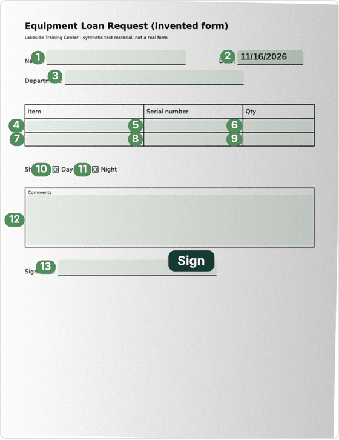
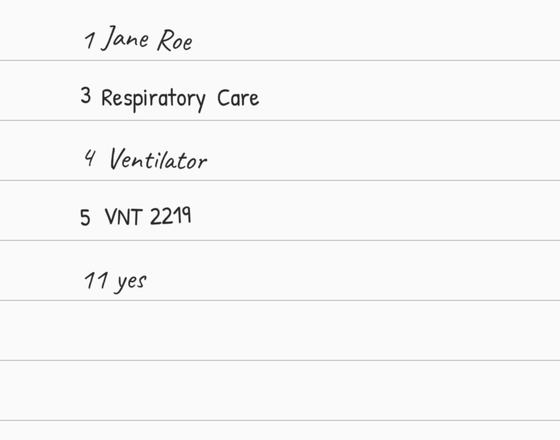
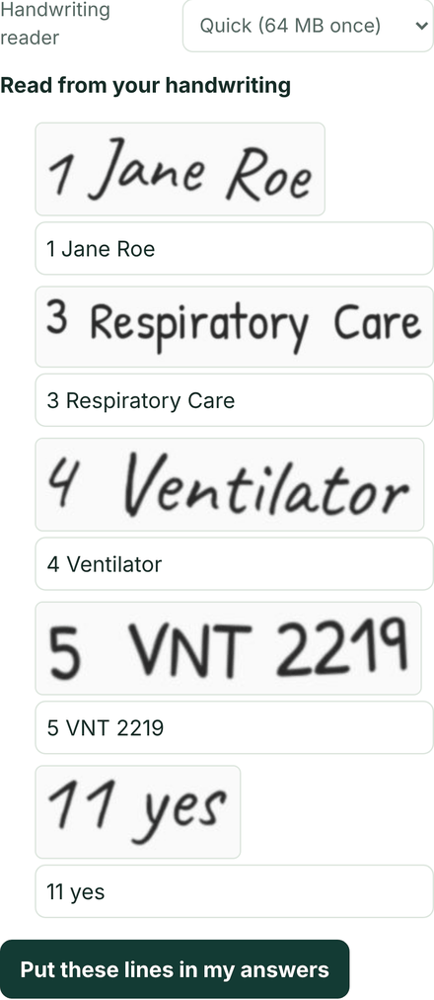
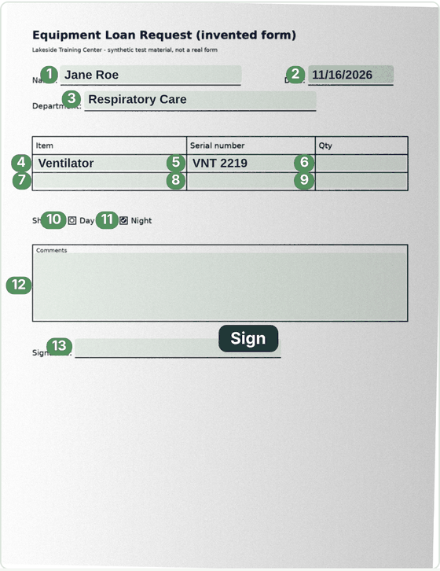
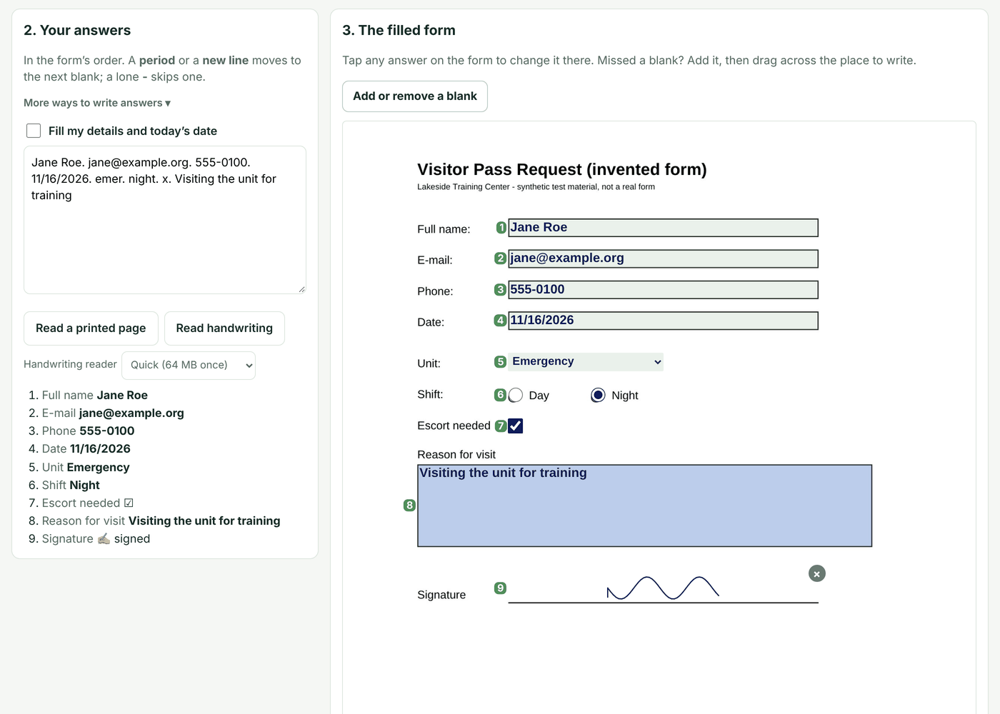

# Form Filler

Photograph or open a form, write your answers anywhere as plain lines, and get the form back filled in: as a PDF you
can still edit, a print-ready PDF, or printed. Everything happens in the browser on your own device; nothing is
uploaded. It installs like an app (Add to Home Screen) and works offline after the first visit.

It is also a library and a command-line tool, so other programs can fill forms with it.

**Open it:** <https://swixixle.github.io/form-filler/>

## How it works: a form from an e-mail, filled from a sheet of paper

The pictures below are the live page. The forms and the handwriting are invented: the "handwriting" is a
handwriting-style font, not a person's hand (see [What it cannot do](#what-it-cannot-do-yet)).

**1. Open the form.** A photo, a screenshot or a PDF. Every place to write is found, shaded and numbered. "Date" is
filled with today.



**2. Write your answers on paper, each after its blank's number,** in any order. Photograph the page and tap
*Read handwriting*.



**3. Check what was read.** Each line is shown beside what the reader made of it, so a wrong word is fixed before it
goes in. The reader runs on the device; the photo is not uploaded.



**4. Each answer is in its blank.** Change any of them on the form itself, sign with a finger, then *Send…* (Mail,
Messages) or download the PDF.



**On a computer**, drop or paste the form onto the page and type the answers beside it; ⌘S downloads the PDF. A PDF
with its own fill-in fields is filled in those fields, radio buttons included.



## The shortcuts

- **Blanks found for you.** From a photo or scan, the blanks are found from the page's own lines: a line to write on,
  an empty box or table cell (beside or under a short label), a checkbox. A crooked photo is straightened. When a PDF
  has its own fill-in fields, those are the blanks, exactly, and they are the fields that get filled; a signature line
  drawn on the page with no field behind it is still found.
- **Loose answers.** One answer after another, in the form's order:
  - a **period** or a **new line** moves to the next blank;
  - a lone **-** (or an extra period, ". .") leaves a blank empty;
  - **4)** or **4:** at the start puts that answer in blank 4 ("4:30" is a time, not a blank number);
  - a period inside a number (7.38), after an initial (J. Smith) or a short title (Dr. St.), in a.m./p.m., or with no
    space after it (jane@example.org) stays in the answer;
  - for a checkbox, **x** or **yes** ticks it; for a choice, its first letters are enough ("emer" picks Emergency).
- **Your details and today's date.** Saved once on the device, then filled into any blank whose label asks for them
  (Name, First/Last name, E-mail, Phone, Address, City, State, ZIP, "City, State, ZIP", Date of birth). A label about
  someone else is left alone ("Patient name", "Emergency contact phone", "Supervisor"). "Date" gets today, but not a
  date of birth, a start, end or due date. Typed answers pass over those blanks, so you type only what is missing.
- **Remembered forms.** A form's blanks are remembered by the form's fingerprint (SHA-256), so the same form opens
  filled-ready at once the next time. A template can be saved as a file and opened on another device.
- **Signing.** Draw your signature with a finger; it goes in the signature blank as a picture, kept to its shape.
  Keeping it on the device for next time is a choice you make each time.
- **Many copies.** A spreadsheet saved as CSV gives one filled copy per row, all in one PDF. Columns match a blank by
  its number ("3"), its label ("Name") or the PDF field's own name; a column that matches nothing is named, not
  guessed. "Get a CSV with this form's columns" gives you the headings to start from.
- **Handwriting.** A photo of your handwritten answers is cut into its lines, and each line is read by a handwriting
  model (TrOCR) running in the browser. Each line's picture is shown beside what was read, so you fix a wrong word
  before it goes in. Two readers, each downloaded once from Hugging Face at a pinned revision: Quick (about 64 MB, the
  default) and Larger (about 338 MB). The larger one is not known to be better: on the synthetic test page it misread
  the date the quick one read right. Your photo never leaves the device; the download does tell Hugging Face your
  address, as any download does.
- **Printed answers.** A photo of a typed or printed page is read with the same text reader that labels the blanks.
- **Answers on paper, by number.** Look at the numbered form, write each answer on paper after its blank's number
  ("3 Jane Roe", "7. ICU", "#9 yes"), in any order, and photograph the paper (Read handwriting, or Read a printed page).
  When most lines start with a number the form has, each goes to that blank. A line whose number could not be read is
  left out and named, never put in order (where it would cover another blank's answer). On the synthetic numbered page
  (handwriting-style fonts) four of five numbers were read; "9 x" came back as "qx". Write a word after the number
  ("9 yes"), not a lone mark.
- **Send it.** Where the device has a share sheet for files (iPhone, iPad, Android, Safari on a Mac), "Send…" hands
  the filled, editable PDF to Mail, Messages or anything else. Elsewhere, download it and attach it.
- **On a computer.** Drop a form anywhere on the page, or paste a screenshot of one; the cursor is then in the answers
  box, which sits beside the form on a wide screen. ⌘S / Ctrl+S downloads the editable PDF.
- **Radio buttons** in a PDF get a button over each of the form's own, so the words beside them stay readable.

Nothing is put on the form without being shown first: every answer sits in its blank on the page and can be changed
there. What a PDF field cannot take (a choice it does not offer, more characters than it allows) is listed, not
dropped. Each download shows its SHA-256 with the form's and the answers', and the PDF records the form and answer
fingerprints.

## Plugging it into other programs

**The library** (`src/lib/index.js`, ES module, Node 22 or a browser; its only dependency is pdf-lib):

```js
import { readFields, readTemplate, placeAnswers, buildPdf } from 'form-filler';
const { blanks } = await readFields(pdfBytes);                     // a PDF's own fields, in points
const { values } = placeAnswers(blanks, 'Jane Roe. jane@example.org. 555-0100. -. icu');
const filled = await buildPdf({ pages: [{ width: 612, height: 792, pdfPage: 0 }], blanks, values, sourcePdf: pdfBytes, editable: true });
```

Also: `findBlanks` (from a page's grayscale pixels), `autofill`, `parseCsv`/`matchColumns`/`rowValues`, `joinPdfs`,
`makeTemplate`, `segmentLines`. Install it from GitHub: `npm install github:Swixixle/form-filler`.

**The command line** (`bin/form-filler.mjs`, no browser, no network):

```sh
form-filler fields form.pdf --out form.json            # a template from a PDF's own fields
form-filler check form.json                            # what a template holds, or what is wrong with it
form-filler fill --template form.json --form form.pdf --answers "Jane Roe. 555-0100. icu" --out filled.pdf
form-filler fill --template form.json --form form.pdf --csv people.csv --out all.pdf
form-filler fill ... --details me.json --today 2026-11-13 --print --strict
```

`--strict` exits 2 if anything could not go in as written. The form must be the file the template was made from
(same SHA-256) unless `--any-form` is given. A photographed form's template carries its page picture, so it needs no
`--form`.

**A template** is plain JSON, checked field by field when read (`src/lib/templates.js` documents it):
`{ formFiller: "template", version: 1, form: { sha256, name, type }, pages: [...], blanks: [...] }`.

**A link** can carry the answers: `https://…/form-filler/#answers=Jane%20Roe.%20555-0100`.

## What it cannot do (yet)

- **The blank numbers sit over the start of a label** on a photographed form ("Na… 1", "Departm… 3" above). The list
  under *Your answers* gives each number with its whole label.
- **Real handwriting has not been measured.** The tests use handwriting-style fonts (Caveat, Patrick Hand) drawn on
  ruled paper. On that page the quick reader read all five lines right in Chromium and one digit wrong in Node (1.4%
  of characters); the larger one got the date wrong (11.6%). A person's own hand will do worse, joined-up writing worst. Lines must be
  written apart from each other; two lines that touch are split at their thinnest row, which can cut a tall letter.
- **A photo taken at an angle** (not just turned) is straightened for rotation only, not perspective.
- **Dotted-line blanks and blanks with no line or box**, such as a gap after a colon: add them by hand.
- **XFA forms** (an Adobe-only kind) cannot have their own fields read; locked PDFs are filled as pictures of their
  pages; PDFs with turned pages use found blanks rather than their own fields.
- **Fonts**: answers are set in Helvetica; letters it cannot draw are swapped for plain ones.
- **Many copies** are print-ready only (each copy's fields would clash with the next).

## Run it

```sh
npm ci
npm test                          # the library and the command line, on invented forms (needs pdftotext, pdftoppm)
npm run build                     # makes dist/
node scripts/walk.cjs dist        # the whole page in Chromium at phone size (needs Playwright)
node scripts/walk.cjs dist --handwriting   # also reads the synthetic handwritten page (downloads 64 MB)
npm run check:handwriting         # the same reader in Node, with a character error rate
```

Or unpack a built folder and run `python3 serve.py` (port 8771). Each push to `main` publishes the page to GitHub
Pages (`.github/workflows/pages.yml`).

On a phone: open the page, then Share → Add to Home Screen (iPhone) or Install app (Android).

The test forms and pages in `tests/fixtures` are invented (`scripts/make-fixtures.py` draws them). The page bundles
Tesseract.js (Apache 2.0), ONNX Runtime Web (MIT), Transformers.js (Apache 2.0), pdf.js (Apache 2.0) and pdf-lib
(MIT); their licence files are copied into the build (`ocr/`, `ort/`, `licenses/`). The handwriting models are
Microsoft's TrOCR in Xenova's ONNX conversion, downloaded at run time, not bundled: Microsoft's code for TrOCR (the
unilm repository) and the base model's card say MIT; the small model's Hugging Face card names no licence (checked
2026-11-13).
